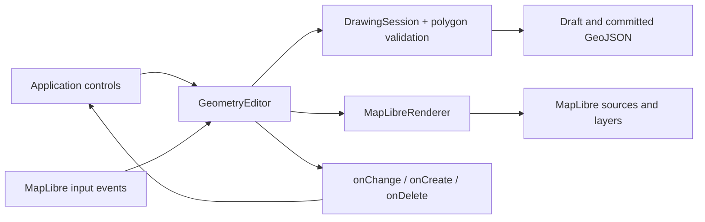

# How the code fits together

The package exposes a geometry editor that attaches to an existing MapLibre map.
Its editing state is independent of MapLibre and the DOM. The renderer and input
controller currently support MapLibre only; no general plugin system is implied.

```text
src/
  index.ts                   Public classes and TypeScript types
  core/
    types.ts                 Coordinates, features, modes, validation diagnostics
    drawing-session.ts       Draft, features indexed by ID, selection, create/edit/delete/export
    transaction.ts           Validate mixed create/update/delete batches before commit
    history.ts               Bounded undo/redo stacks of committed feature changes
    geojson-import.ts        Validate/copy entire import batches and JSON properties
    polygon.ts               Ring validity, closure, exterior winding
    split-polygon.ts         Restricted two-crossing splitter and result validation
    snapping.ts              Projected candidate index, nearest vertex/edge policy
  maplibre/
    geometry-editor.ts       Public API, map input, events, gesture/lifecycle cleanup
    renderer.ts              Sources/layers, picking, selection styling, draft vertices
    snapping.ts              Map projection and camera/data-revision cache
    vertex-interaction.ts    Pointer capture, vertex gestures, cancellation
    vertex-handles.ts        Shared screen-space corner/midpoint definitions
    line-editor.ts           Compatibility facade for the earlier line-only API
examples/basic/              Consumer UI; calls the same API as another app would
tests/                       Core behavior and isolated packed-package integration
  browser/                   Actual MapLibre/Chromium interaction and demo tests
```

## Following one polygon through the code

1. A demo button calls `editor.draw('Polygon')`. The controller tells
   `DrawingSession.start()` to enter drawing mode, focuses the canvas, switches
   the cursor, and temporarily disables double-click zoom.
2. MapLibre supplies a click in screen pixels. The controller ignores drag
   gestures, unsupported modifiers, and double-click duplicates. It checks the
   polygon close target, then resolves optional snapping against existing geometry
   (Alt bypasses snapping). It passes the resulting geographic coordinate to
   `DrawingSession.add()`.
3. The session copies the coordinate into its draft and validates the proposed
   ring. It stores the result so `getState()` and UI updates are cheap. The
   session neither calls MapLibre nor creates DOM elements.
4. The controller schedules a preview and notifies `onChange` subscribers.
   `MapLibreRenderer` turns clicked points plus the cursor into temporary
   GeoJSON. MapLibre draws the orange outline/fill and vertex circles. The demo
   uses state to update instructions and enable/disable Finish.
5. Enter, Finish, or clicking the first corner calls `finish()`. The session
   refuses invalid drafts; otherwise it closes/normalizes the ring, assigns a
   UUID, stores the committed feature, and clears the draft.
6. The controller restores map gestures and cursor. The renderer clears the
   draft source and updates the committed source. `onCreate` receives the saved
   feature once; `onChange` reports idle state. The demo refreshes its export.
7. `exportGeoJSON()` copies committed data from the session. No screenshot,
   visible-feature query, or reconstruction from MapLibre layers is needed.
   The host can download this snapshot or save it using its own backend.



## Why these boundaries matter

Selection uses the same boundary. An idle click asks the renderer to query only
the editor's committed layers. It returns a feature ID, which the session stores
in its selection Set; no geometry is rewritten. The controller updates MapLibre
feature state for the previous/new selection and emits `onChange`. A toolbar can
use `getSelection()` for isolated snapshots, or `select(null)` to clear selection.

Feature IDs are indexed in an insertion-ordered Map, so selecting by ID does not
scan all geometries. Type-encoded IDs are promoted from a private rendering property to keep
them intact through MapLibre's vector-tile conversion. That detail stays entirely
inside the renderer and never appears in exported GeoJSON.

Deleting follows a committed change path: `deleteSelected()` asks the session
to copy and remove the selected feature, then clears selection. The controller
clears the highlight, uploads the remaining features, emits `onDelete` with
independent snapshots, and emits `onChange` for the updated UI. A second call
without a selection does nothing. The core remains authoritative while MapLibre
updates asynchronously: stale hits for removed IDs are ignored by the controller.

The session is the single source of truth. A preview cannot accidentally enter
exports, cancellation cannot delete committed features, and callbacks cannot
mutate internal state through shared references. Geometry tests run without a
browser. Browser tests separately cover actual input, rendering, and cleanup.

The renderer owns namespaced layers and sources, so teardown removes only its
resources. It rebuilds them on style changes. A WeakSet prevents competing
editors on one map while independent maps remain supported. A map removal also
disposes its editor; explicit destroy is safe to repeat.

Editing copies the selected feature into the draft. Vertex operations change
only that draft; finish replaces the stored geometry while keeping its ID and
properties. The controller emits onUpdate only when dataRevision changed. Cancel
discards the draft, so there is no stored geometry to reconstruct.

Import validates a whole batch before appending it to the store. It checks
coordinates, topology, IDs, and nested JSON properties, reserves explicit IDs,
and generates missing ones. A failure leaves existing data and selection intact.
The controller uploads once and emits one onImport event for a nonempty batch.
Export/import use core data, so neither requires reading rendered map layers.

All committed mutations use DrawingSession.commit, including drawing, saved edits,
deletions, imports, and explicit transactions. Transaction preparation validates
the whole mixed batch before committing anything. A common applyChanges path
handles forward changes and replay, sorting restoration positions to preserve
collection order after multiple deletions. See the [transaction guide](transactions.md).

Committed mutations record changed feature versions in EditHistory. Internal
versions never escape the session, so entries can retain immutable references
instead of copying every feature. An edit stores its before/after versions;
an import stores one batch. Replay changes the core store, preserves collection
order, checks whether the current selection still exists, and increments the
revision once. The controller refreshes the map and emits one onHistory event.
An action-count limit and clearHistory release old references; destruction also
clears both stacks. UI selection and unfinished drafts never enter history.

Snapping sits before draft mutation. `core/snapping.ts` accepts projection
functions instead of importing MapLibre. It indexes vertex points and edge bounds
in a static binary hierarchy, checks nearby candidates, and gives vertices
priority. Exact vertices reuse source coordinates; edge interiors are inverse
projected. `maplibre/snapping.ts` keeps one committed snapshot per data revision
and caches the projected index until data or the camera changes. Pointer moves
resolve at most once per animation frame; click resolution is synchronous.
The controller applies the same resolved coordinate to preview and draft input.
Snap notifications and the purple marker are transient; `DrawingSession` stores
only the resolved coordinate. Committed shapes and history are unchanged
until a normal drawing/editing commit. There is no second geometry store to synchronize.
See the [snapping contract](geometry-editor.md#snapping-while-drawing) and
[performance baseline](performance.md#drawing-snapping) for scope and costs.

Application code should not have to learn which
MapLibre source holds a selected feature. Avoid creating one wrapper method for
every MapLibre camera or basemap operation: those operations already belong to
the host's map API.

The library has no built-in toolbar or framework dependency. `examples/basic`
is one consumer of the API, making a React/Vue/custom UI possible without
changing the geometry engine. Styling and rendering options can be introduced
through a deliberate public contract when a real use case needs them.


Splitting retains the selected polygon while the session holds a separate cutting
line and cached preview. Clicking or replacing the cut invokes splitPolygon;
hover does not repeat topology calculations. The renderer shows the proposed
parts in different colors. Confirmation validates one update/create batch and
uses the common transaction commit path. Preview allocates no IDs and never enters
exports/history; cancel discards it. See the [split guide](splitting.md).

## Vertex-drag snapping

`VertexInteraction` retains the latest screen point and Alt state during pointer
capture. Each animation frame resolves that point through the same MapLibre
snapping adapter as drawing, then moves the draft vertex and validates it.
Release resolves again before ending the gesture. Modifier, option and camera
changes can refresh a stationary drag. Programmatic vertex methods remain exact.

The query excludes the selected feature by its typed ID, skipping its saved
vertices and edges inside the existing index. Changing edit targets requires no
index rebuild. Draft movement changes neither the data revision nor the committed
snapshot. Cancellation rolls back the gesture and clears the marker; Save still
uses the normal edit/history path. There is no topology relationship to targets.

## Multiple selection

`DrawingSession` holds an ordered Set of typed IDs separately from feature data.
The legacy singular getter derives a value only when the set has one member; the
new array and feature getters return copies. `selectMany` validates the whole
request before replacing the set. The shared commit/replay path prunes deleted
IDs, so all data operations follow the same selection policy. Selection itself
does not enter history. Group deletion reuses the transaction boundary.

`SelectionInteraction` owns Shift+mouse pointer capture and a temporary DOM
rectangle over the canvas. It restores pan/boxZoom settings on every exit. A
completed rectangle asks the renderer for intersecting rendered editor features;
the controller filters stale IDs and updates the selection once. Camera/style
changes and API mutations abort the gesture. Rendering diffs the old/new sets
and changes only their MapLibre feature states without uploading geometry.
