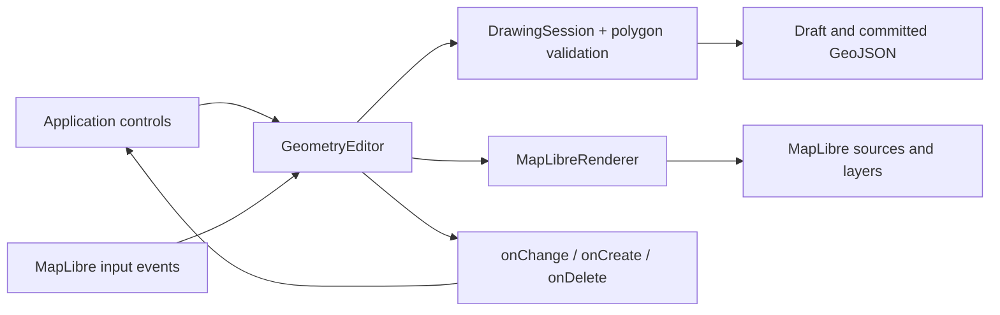

# How the code fits together

The package exposes a geometry editor that attaches to an existing MapLibre map.
Its editing state is independent of MapLibre and the DOM. The renderer and input
controller currently support MapLibre only; no general plugin system is implied.

```text
src/
  index.ts                   Public classes and TypeScript types
  core/
    types.ts                 Coordinates, features, modes, validation diagnostics
    drawing-session.ts       Draft, features indexed by ID, selection, create/edit/delete/export
    geojson-import.ts        Validate/copy entire import batches and JSON properties
    polygon.ts               Ring validity, closure, exterior winding
  maplibre/
    geometry-editor.ts       Public API, map input, events, gesture/lifecycle cleanup
    renderer.ts              Sources/layers, picking, selection styling, draft vertices
    vertex-interaction.ts    Pointer capture, vertex gestures, cancellation
    vertex-handles.ts        Shared screen-space corner/midpoint definitions
    line-editor.ts           Compatibility facade for the earlier line-only API
examples/basic/              Consumer UI; calls the same API as another app would
tests/                       Core behavior and isolated packed-package integration
  browser/                   Actual MapLibre/Chromium interaction and demo tests
```

## Following one polygon through the code

1. A demo button calls `editor.draw('Polygon')`. The controller tells
   `DrawingSession.start()` to enter drawing mode, focuses the canvas, switches
   the cursor, and temporarily disables double-click zoom.
2. MapLibre supplies a click position in longitude/latitude. The controller
   ignores drag gestures, modified clicks, and double-click duplicates, then
   passes the coordinate to `DrawingSession.add()`.
3. The session copies the coordinate into its draft and validates the proposed
   ring. It stores the result so `getState()` and UI updates are cheap. The
   session neither calls MapLibre nor creates DOM elements.
4. The controller schedules a preview and notifies `onChange` subscribers.
   `MapLibreRenderer` turns clicked points plus the cursor into temporary
   GeoJSON. MapLibre draws the orange outline/fill and vertex circles. The demo
   uses state to update instructions and enable/disable Finish.
5. Enter, Finish, or clicking the first corner calls `finish()`. The session
   refuses invalid drafts; otherwise it closes/normalizes the ring, assigns a
   UUID, stores the committed feature, and clears the draft.
6. The controller restores map gestures and cursor. The renderer clears the
   draft source and updates the committed source. `onCreate` receives the saved
   feature once; `onChange` reports idle state. The demo refreshes its export.
7. `exportGeoJSON()` copies committed data from the session. No screenshot,
   visible-feature query, or reconstruction from MapLibre layers is needed.
   The host can download this snapshot or save it using its own backend.



## Why these boundaries matter

Selection uses the same boundary. An idle click asks the renderer to query only
the editor's committed layers. It returns a feature ID, which the session stores
as `selectedFeatureId`; no geometry is rewritten. The controller updates MapLibre
feature state for the previous/new selection and emits `onChange`. A toolbar can
use `getSelected()` for an isolated snapshot, or `select(null)` to clear selection.

Feature IDs are indexed in an insertion-ordered Map, so selecting by ID does not
scan all geometries. Type-encoded IDs are promoted from a private rendering property to keep
them intact through MapLibre's vector-tile conversion. That detail stays entirely
inside the renderer and never appears in exported GeoJSON.

Deleting follows a committed change path: `deleteSelected()` asks the session
to copy and remove the selected feature, then clears selection. The controller
clears the highlight, uploads the remaining features, emits `onDelete` with
independent snapshots, and emits `onChange` for the updated UI. A second call
without a selection does nothing. The core remains authoritative while MapLibre
updates asynchronously: stale hits for removed IDs are ignored by the controller.

The session is the single source of truth. A preview cannot accidentally enter
exports, cancellation cannot delete committed features, and callbacks cannot
mutate internal state through shared references. Geometry tests run without a
browser. Browser tests separately cover actual input, rendering, and cleanup.

The renderer owns namespaced layers and sources, so teardown removes only its
resources. It rebuilds them on style changes. A WeakSet prevents competing
editors on one map while independent maps remain supported. A map removal also
disposes its editor; explicit destroy is safe to repeat.

Editing copies the selected feature into the draft. Vertex operations change
only that draft; finish replaces the stored geometry while keeping its ID and
properties. The controller emits onUpdate only when dataRevision changed. Cancel
discards the draft, so there is no stored geometry to reconstruct.

Import validates a whole batch before appending it to the store. It checks
coordinates, topology, IDs, and nested JSON properties, reserves explicit IDs,
and generates missing ones. A failure leaves existing data and selection intact.
The controller uploads once and emits one onImport event for a nonempty batch.
Export/import use core data, so neither requires reading rendered map layers.

Future history should extend the editor API and core commit behavior. Application code should not have to learn which
MapLibre source holds a selected feature. Avoid creating one wrapper method for
every MapLibre camera or basemap operation: those operations already belong to
the host's map API.

The library has no built-in toolbar or framework dependency. `examples/basic`
is one consumer of the API, making a React/Vue/custom UI possible without
changing the geometry engine. Styling and rendering options can be introduced
through a deliberate public contract when a real use case needs them.
