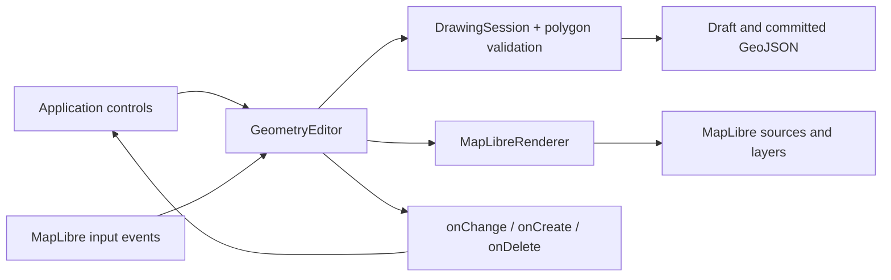

# How the code fits together

The package exposes a geometry editor that attaches to an existing MapLibre map.
Its editing state is independent of MapLibre and the DOM. The renderer and input
controller currently support MapLibre only; no general plugin system is implied.

```text
src/
  index.ts                   Public classes and TypeScript types
  core/
    appearance.ts            Typed defaults, independent snapshots and atomic appearance validation
    types.ts                 Coordinates, features, modes, validation diagnostics
    drawing-session.ts       Draft, features indexed by ID, selection, create/edit/delete/export
    translation.ts           Translate coordinates from an immutable baseline in degrees
    transaction.ts           Validate mixed create/update/delete batches before commit
    history.ts               Bounded undo/redo stacks of committed feature changes
    geojson-import.ts        Validate/copy entire import batches and JSON properties
    polygon.ts               Ring validity, closure, exterior winding
    union.ts                 Polygon union adapter
    drawing-constraints.ts   Validated angle options and pure Mercator ray constraint
    mercator-transform.ts    Shared projection, pivot validation and bounds centre
    rotation.ts              Angle normalization and baseline rotation
    offset.ts                Signed Mercator miter offsets and simple-path validation
    buffer.ts                Positive Mercator dilation with polygonal capsules and union
    simplification.ts        Iterative path/ring simplification in Mercator meters
    scaling.ts               Positive factor validation and baseline scaling
    shared-boundary.ts       Exact shared-chain discovery and paired result validation
    trace-boundary.ts        Explicit source addressing, attachment and route selection
    reshape-polygon.ts       Boundary attachments, arc choice and strict route validation
    intersection.ts          Common area of every input; valid empty results
    difference.ts            Target subtraction, empty and exact no-op results
    polygon-overlay.ts       Shared strict overlay result validation
    split-polygon.ts         Restricted two-crossing splitter and result validation
    geometry.ts              Component views/replacement and coordinate mapping
    snapping.ts              Projected candidate index, nearest vertex/edge policy
  maplibre/
    geometry-editor.ts       Public API and coordination between core, input and rendering
    editor-events.ts         Typed subscriptions, snapshot delivery and error isolation
    keyboard-interaction.ts  Canvas-focused finish/cancel/delete/history commands
    pointer.ts               Shared viewport-to-map CSS coordinate conversion
    renderer.ts              Sources/layers, picking, selection styling, draft vertices
    reshape-snapping.ts      Target-only boundary attachment and camera cache
    snapping.ts              Map projection and camera/data-revision cache
    selection-interaction.ts Shift+click/rectangle selection and cancellation
    translation-interaction.ts Group drag preview, release and cancellation
    pivot-interaction.ts     Shared rotation/scale pivot input, original-target snapping and rollback
    distance-interaction.ts  Buffer/offset distance handle, ruler and drag rollback
    preview-border.ts        Explicit dots per edge for every preview; optional drag fill
    vertex-interaction.ts    Pointer capture, vertex gestures, cancellation
    vertex-handles.ts        Shared screen-space corner/midpoint definitions
    line-editor.ts           Compatibility facade for the earlier line-only API
examples/basic/              Consumer UI; calls the same API as another app would
examples/workspace/          Installed consumer with storage and host-owned appearance presets
tests/                       Core behavior, boundary checks and packed-package integration
  browser/                   Actual MapLibre/Chromium interaction and demo tests
```

## Where to make a change

| Task | Start here | Verification |
| --- | --- | --- |
| Integrate into an application | [API guide](geometry-editor.md), `examples/basic/main.ts` | `tests/fixtures/consumer/`, demo browser tests |
| Add a geometry operation | `core/` algorithm, then `DrawingSession` | Core behavior tests, operation benchmark |
| Change committed data or Undo | `core/transaction.ts`, `drawing-session.ts`, `history.ts` | Transaction/history tests, mixed selections and failure cases |
| Add a mouse gesture | Corresponding `maplibre/*-interaction.ts`, wired in `GeometryEditor` | Browser tests for release, Escape, blur, style changes and destruction |
| Change keyboard shortcuts | `maplibre/keyboard-interaction.ts` | Browser tests for focus, modifiers and current mode |
| Change event delivery | `maplibre/editor-events.ts`; emission stays in the controller | Observer mutation/error/unsubscribe tests in browser suites |
| Change map appearance or picking | `maplibre/renderer.ts` | Browser rendering/selection tests |
| Change toolbar or instructions | `examples/basic/` | Demo tests and visual review |
| Expose a public capability | `src/index.ts`, `core/types.ts`, editor facade | Packed-consumer fixture and API documentation |

The core imports only other core modules and geometry dependencies. The adapter
imports the core. The demo imports the public package. Avoid using `src/index.ts`
as an internal shortcut: it would pull the adapter back into lower-level modules.

## Following one polygon through the code

1. A demo button calls `editor.draw('Polygon')`. The controller tells
   `DrawingSession.start()` to enter drawing mode, focuses the canvas, switches
   the cursor, and temporarily disables double-click zoom.
2. MapLibre supplies a click in screen pixels. The controller ignores drag
   gestures, unsupported modifiers, and double-click duplicates. It checks the
   polygon close target, then resolves optional snapping against existing geometry
   (Alt bypasses snapping). It passes the resulting geographic coordinate to
   `DrawingSession.add()`.
3. The session copies the coordinate into its draft and validates the proposed
   ring. It stores the result so `getState()` and UI updates are cheap. The
   session neither calls MapLibre nor creates DOM elements.
4. The controller schedules a preview and notifies `onChange` subscribers.
   `MapLibreRenderer` turns clicked points plus the cursor into temporary
   GeoJSON. MapLibre draws the orange outline/fill and vertex circles. The demo
   uses state to update instructions and enable/disable Finish.
5. Enter, Finish, or clicking the first corner calls `finish()`. The session
   refuses invalid drafts; otherwise it closes/normalizes the ring, assigns a
   UUID, stores the committed feature, and clears the draft.
6. The controller restores map gestures and cursor. The renderer clears the
   draft source and updates the committed source. `onCreate` receives the saved
   feature once; `onChange` reports idle state. The demo refreshes its export.
7. `exportGeoJSON()` copies committed data from the session. No screenshot,
   visible-feature query, or reconstruction from MapLibre layers is needed.
   The host can download this snapshot or save it using its own backend.



## Why these boundaries matter

Selection uses the same boundary. An idle click asks the renderer to query only
the editor's committed layers. It returns a feature ID, which the session stores
in its selection Set; no geometry is rewritten. The controller updates MapLibre
feature state for the previous/new selection and emits `onChange`. A toolbar can
use `getSelection()` for isolated snapshots, or `select(null)` to clear selection.

Feature IDs are indexed in an insertion-ordered Map, so selecting by ID does not
scan all geometries. Type-encoded IDs are promoted from a private rendering property to keep
them intact through MapLibre's vector-tile conversion. That detail stays entirely
inside the renderer and never appears in exported GeoJSON.

Deleting follows a committed change path: `deleteSelected()` asks the session
to copy and remove the selected feature, then clears selection. The controller
clears the highlight, uploads the remaining features, emits `onDelete` with
independent snapshots, and emits `onChange` for the updated UI. A second call
without a selection does nothing. The core remains authoritative while MapLibre
updates asynchronously: stale hits for removed IDs are ignored by the controller.

The session is the single source of truth. A preview cannot accidentally enter
exports, cancellation cannot delete committed features, and callbacks cannot
mutate internal state through shared references. Geometry tests run without a
browser. Browser tests separately cover actual input, rendering, and cleanup.

The renderer owns namespaced layers and sources, so teardown removes only its
resources. It rebuilds them on style changes. A WeakSet prevents competing
editors on one map while independent maps remain supported. A map removal also
disposes its editor; explicit destroy is safe to repeat.

Editing copies the selected feature into the draft. Vertex operations change
only that draft; finish replaces the stored geometry while keeping its ID and
properties. The controller emits onUpdate only when dataRevision changed. Cancel
discards the draft, so there is no stored geometry to reconstruct.

Import validates a whole batch before appending it to the store. It checks
coordinates, topology, IDs, and nested JSON properties, reserves explicit IDs,
and generates missing ones. A failure leaves existing data and selection intact.
The controller uploads once and emits one onImport event for a nonempty batch.
Export/import use core data, so neither requires reading rendered map layers.

All committed mutations use DrawingSession.commit, including drawing, saved edits,
deletions, imports, and explicit transactions. Transaction preparation validates
the whole mixed batch before committing anything. A common applyChanges path
handles forward changes and replay, sorting restoration positions to preserve
collection order after multiple deletions. See the [transaction guide](transactions.md).

Committed mutations record changed feature versions in EditHistory. Internal
versions never escape the session, so entries can retain immutable references
instead of copying every feature. An edit stores its before/after versions;
an import stores one batch. Replay changes the core store, preserves collection
order, checks whether the current selection still exists, and increments the
revision once. The controller refreshes the map and emits one onHistory event.
An action-count limit and clearHistory release old references; destruction also
clears both stacks. UI selection and unfinished drafts never enter history.

Snapping sits before draft mutation. `core/snapping.ts` accepts projection
functions instead of importing MapLibre. It indexes vertex points and edge bounds
in a static binary hierarchy, checks nearby candidates, and gives vertices
priority. Exact vertices reuse source coordinates; edge interiors are inverse
projected. `maplibre/snapping.ts` keeps one committed snapshot per data revision
and caches the projected index until data or the camera changes. Pointer moves
resolve at most once per animation frame; click resolution is synchronous.
The controller applies the same resolved coordinate to preview and draft input.
Snap notifications and the purple marker are transient; `DrawingSession` stores
only the resolved coordinate. Committed shapes and history are unchanged
until a normal drawing/editing commit. There is no second geometry store to synchronize.
See the [snapping contract](geometry-editor.md#snapping-while-drawing) and
[performance baseline](performance.md#drawing-snapping) for scope and costs.

Application code should not have to learn which
MapLibre source holds a selected feature. Avoid creating one wrapper method for
every MapLibre camera or basemap operation: those operations already belong to
the host's map API.

The library has no built-in toolbar or framework dependency. `examples/basic`
is one consumer of the API, making a React/Vue/custom UI possible without
changing the geometry engine. Styling and rendering options can be introduced
through a deliberate public contract when a real use case needs them.


Splitting retains the selected polygon while the session holds a separate cutting
line and cached preview. Clicking or replacing the cut invokes splitPolygon;
hover does not repeat topology calculations. The renderer shows the proposed
parts in different colors. Confirmation validates one update/create batch and
uses the common transaction commit path. Preview allocates no IDs and never enters
exports/history; cancel discards it. See the [split guide](splitting.md).

## Vertex-drag snapping

`VertexInteraction` retains the latest screen point and Alt state during pointer
capture. Each animation frame resolves that point through the same MapLibre
snapping adapter as drawing, then moves the draft vertex and validates it.
Release resolves again before ending the gesture. Modifier, option and camera
changes can refresh a stationary drag. Programmatic vertex methods remain exact.

The query excludes the selected feature by its typed ID, skipping its saved
vertices and edges inside the existing index. Changing edit targets requires no
index rebuild. Draft movement changes neither the data revision nor the committed
snapshot. Cancellation rolls back the gesture and clears the marker; Save still
uses the normal edit/history path. There is no topology relationship to targets.

## Multiple selection

`DrawingSession` holds an ordered Set of typed IDs separately from feature data.
The legacy singular getter derives a value only when the set has one member; the
new array and feature getters return copies. `selectMany` validates the whole
request before replacing the set. The shared commit/replay path prunes deleted
IDs, so all data operations follow the same selection policy. Selection itself
does not enter history. Group deletion reuses the transaction boundary.

`SelectionInteraction` owns Shift+mouse pointer capture and a temporary DOM
rectangle over the canvas. It restores pan/boxZoom settings on every exit. A
completed rectangle asks the renderer for intersecting rendered editor features;
the controller filters stale IDs and updates the selection once. Camera/style
changes and API mutations abort the gesture. Rendering diffs the old/new sets
and changes only their MapLibre feature states without uploading geometry.

## Group translation

`TranslationInteraction` starts only on a selected committed hit while idle. It
captures one selection snapshot, suspends pan, and computes a shared geographic
offset from the original pointer position. Animation frames translate only that
snapshot. The renderer hides originals through feature state and projects the
moving group into SVG fills and explicit dots using the same `PreviewBorder` as
drawing, vertex editing and geometry-operation previews. Each edge measures dots
from its own start at 9 CSS pixel intervals, without a dash pattern or animation.
Changing an earlier edge cannot shift dots on untouched edges. Dot generation
clips the visible index range without resetting its origin at viewport boundaries. The authoritative store is unchanged.

Release draws the exact final pointer position and calls the session translation. The core
translates selected features and passes the complete batch through transaction
validation and the existing commit boundary. One revision, one event, and one
history entry cover the whole group. The renderer keeps the final SVG and hides
the old committed tiles until source processing and visible tile loading finish.
It restores opacity without a transition, then removes SVG after a rendered frame.
Revision checks prevent superseded uploads from clearing a newer preview; style
replacement and teardown remove listeners and SVG paths. Cancelling clears preview/feature state and
restores capture, pan and cursor; API mutations cancel before touching the store.

## Event and input ownership

The controller emits through `EditorEvents` after updating authoritative data and
rendering. A snapshot factory runs once per listener, so one observer cannot
mutate another observer's payload. State events read the current state for each
observer, preserving synchronous callback behavior. Exceptions are queued to the
owning window and do not stop later observers. Destroy clears every subscription.

`KeyboardInteraction` listens only to the canvas. Gesture handlers intercept
Escape in the capture phase first, preserving the difference between cancelling
an active gesture and deselecting an idle group. Alt snapping also needs keyup and
window blur, so it stays with the snapping coordination in `GeometryEditor`.
Each input module removes its own listeners; the controller owns overall teardown.

`canvasPoint` converts pointer positions through the canvas's rendered bounds.
Only rectangle selection clamps the result to the canvas. Vertex and group drags
retain captured coordinates outside it. Keeping that policy at the caller avoids
silently changing drag behavior when the shared conversion is updated.

## Duplication

`duplicateSelection()` captures the committed selection, applies the optional
degree offset through the existing translation helper, and reserves fresh IDs for
the entire batch. `allocateId` checks both the store and these pending reservations.
The operation passes its full create batch to transaction validation and commits
once. Only after success does it replace selection with the new IDs.

The controller cancels transient idle gestures first, then reuses
`publishTransaction` to update highlights, upload committed data, and emit the
complete transaction followed by state. No new gesture or event system is needed.
The demo owns the small visual offset; the core default is an exact copy. Redo
replays stored changes, so it does not allocate replacement IDs.

## Polygon rings

`polygon.ts` owns both single-ring validation and relations between rings:
robust boundary intersection, strict containment, and rejection of nested holes.
`geojson-import.ts` checks input structure and normalizes exterior/hole winding;
transactions reuse this import boundary.

`DrawingSession` keeps one active open-ring draft and its ring index. Other rings
come from the immutable committed target. `getDraftRings()` assembles independent
preview snapshots; Finish validates all rings and commits one complete feature.
Existing vertex handles and gestures use ring-local indices without another
interaction system. The renderer draws all rings but exposes handles only on the
active ring. The demo owns the ring selector and tool labels.

`SnapIndex` includes all rings and reports ring indices for polygon candidates.
`splitPolygonRings` wraps the existing exterior splitter, assigns untouched holes
to their result, rejects intersected holes and chooses the retained ID by filled
planar area. Splitting multipart features remains unsupported.


## Multipart components

`geometry.ts` centralizes geometry traversal: component views, replacing one
component, mapping every position, and building correctly typed features. These
helpers keep copy/translation/duplication and snapping from assuming a fixed
coordinate depth. Helpers returning component views share coordinates; only
isolated snapshots may be mutated by callers.

Import validates every component and normalizes its rings. `validateMultiPolygon`
checks component boundaries and filled-area containment, allowing islands inside
holes. Bounding boxes skip disjoint component comparisons; the exact predicates
still check touching extents.

The session keeps a simple line/ring draft plus `activePartIndex` and
`activeRingIndex`. It replaces that component in a candidate geometry to validate
and commit the whole feature. `getInactiveParts()` supplies independent preview
snapshots for the other components while the committed version is hidden. Handles
belong only to the active draft. No second feature store or per-part history is
introduced. The renderer's normal GeoJSON sources handle multipart committed data.

Snapping walks every component/ring and returns their indices. Selection and
translation still use whole feature IDs. The demo owns the component selector and
uses only public APIs; changing its selector does not mutate editor data.

## Polygon union

`unionSelection()` passes the complete polygon selection to `core/union.ts`, which
wraps polygon-clipping and validates its result using the existing strict multipart
policy. The session caches that geometry (or a diagnostic) in `union-polygons` mode.
The renderer hides all selected inputs only when the preview is valid and uploads
the proposed Polygon/MultiPolygon to the draft source. Camera changes do not repeat
the overlay calculation; style replacement reconstructs the preview.

`finishUnion()` prepares an update for the first selected ID and deletes the other
inputs, then commits once through the transaction boundary. Cancel discards only
the preview. `finish()` routes to this operation for Enter and the demo button;
`onTransaction` and `onHistory` preserve the normal batch contract. See [union](union.md)
for property ownership, unsupported topology and numerical limits.

## Polygon difference

`differenceSelection()` freezes the selection and uses its first polygon as the
target. `core/difference.ts` checks for filled-area overlap before subtraction so
no-op results preserve exact input representation. Valid empty output has an
explicit `{ geometry: null }` preview; it does not pass through the nonempty
validator. Union, difference and intersection use `core/polygon-overlay.ts` for nonempty
result validation and winding normalization.

The session caches the preview in `difference-polygons` mode. Confirmation prepares
one target update or deletion through the transaction boundary; cutting features
are preserved. No-op confirmation cancels review without recording history.
The renderer hides only the target for valid previews, including empty results.
See [difference](difference.md) for API, events and numerical limits.

## Polygon intersection

`intersectionSelection()` freezes the full polygon selection. `core/intersection.ts`
folds intersection across whole operands (MultiPolygon components stay together),
short-circuits empty output and validates only the final nonempty result through
`core/polygon-overlay.ts`. The session caches `{ geometry }` or a failure diagnostic.
The renderer hides all inputs for a valid preview, including empty results.
Confirmation retains the first selected ID for nonempty output and deletes the
other inputs; empty output deletes every selected feature. The transaction boundary
handles validation, one history action, events and exact replay. See
[intersection](intersection.md) for the full contract.

## Polygon reshape

`reshapeSelected()` freezes one selected single-ring Polygon. The session stores
its ID, draft route, selected boundary side and cached diagnostic/result.
`core/reshape-polygon.ts` inserts boundary attachments, rejects route crossings and
extra contacts, selects the old arc by planar length and validates the new ring.
`maplibre/reshape-snapping.ts` supplies target-only attachments with an 18px radius,
independent of general snapping. Its index is rebuilt only after camera changes.
The original remains visible until a valid result is ready. The shared preview
renderer draws the result and route handles; Backspace reopens construction.
Confirmation uses the existing transaction boundary for one update. See
[reshape](reshape.md) for numerical, event and lifecycle contracts.

## Boundary tracing

`core/trace-boundary.ts` resolves an explicitly addressed source line/ring and
constructs the route between attachments. `DrawingSession.traceBoundary()` appends
all corners at once, validates once, and records a draft-step length for correction.
`GeometryEditor` coordinates mouse anchors, a cached prospective route and tracing
settings; `MapLibreSnapping` maps edge acquisition onto planar source segments.
`MapLibreRenderer` adds the prospective route only to preview geometry, leaving
clicked vertex handles/state untouched. Completion uses normal drawing history.
See [tracing](tracing.md) for the complete contract.

## Shared-boundary editing

`core/shared-boundary.ts` finds one reversed matching edge chain, retains the other
polygon arcs and checks both result rings plus their pairwise overlap. The session
owns the shared-chain draft and cached two-feature preview. It reuses vertex editing
commands with fixed endpoint guards and commits through the existing transaction
boundary. The renderer hides both originals only for a valid preview. Vertex input
reuses pointer cancellation and excludes both source IDs from the snapping index.
See [shared boundaries](shared-boundaries.md) for the public contract.

## Selection rotation

`core/mercator-transform.ts` computes the fixed projected bounds centre;
`core/rotation.ts` rotates every
coordinate from immutable selected originals. `DrawingSession` owns the angle,
pivot and cached result, using transaction preparation for preview validation and
again before committing. `GeometryEditor` exposes the review lifecycle; the renderer
shows selected result geometry and a pivot marker without committed-source uploads.
The host demo owns numeric/step controls; map shortcuts reuse Enter/Escape handling.
`maplibre/rotation-interaction.ts` owns the mouse/keyboard handle, screen-aligned
SVG frame and ghost outline. It measures pointer directions in the same Mercator
plane after unprojecting the camera, coalesces previews, restores interrupted
drags and releases its DOM/listeners with the editor. It does not commit on release.
See [rotation](rotation.md) for coordinate conventions, limits and event semantics.

## Selection scaling

`core/scaling.ts` scales each stored vertex along two positive Mercator axes,
sharing projection and pivot rules with rotation. DrawingSession freezes selected
originals and the pivot, validates candidates through prepareTransaction, and
caches the preview/error until the next factor change. Confirmation revalidates
and records one transaction. The MapLibre adapter shares the transform renderer
with rotation, hides valid-preview originals and restores them on cancellation.
`maplibre/scaling-interaction.ts` owns the eight frame handles, pointer capture,
axis-specific keyboard resizing and drag rollback. It updates the same factors
as numeric input; release keeps the preview open.
See [scaling](scaling.md) for factor, coordinate and lifecycle contracts.

`maplibre/pivot-interaction.ts` owns the shared pivot handle and a camera-dependent
SnapIndex built from the selected originals. It adds the original projected
centre as a target. Pivot setters reuse the same session transformation and
validation paths as angle/factor changes, retaining the frozen baseline. Camera
changes invalidate the snap index; teardown releases captures, handlers and DOM.

## Drawing constraints

`core/drawing-constraints.ts` validates opt-in 45°/90° options and constrains a
pointer coordinate to a Mercator direction from a supplied anchor. The adapter
applies it after exact snapping/closure acquisition, only for line/polygon/hole
drawing. The session supplies a constant-time copied anchor; the complete draft
is not copied for this new calculation. Rejected out-of-range candidates neither
render nor append a point. Existing tracing, commit and history paths are reused.

## Selection simplification

`core/simplification.ts` simplifies projected paths using an explicit stack and
retained source indices. Rings are processed as two anchored arcs. DrawingSession
freezes selected originals, validates candidates with prepareTransaction, and
caches the result/error. The adapter uses the shared collection-preview renderer
without a pivot. Confirmation uses the existing transaction/history boundary.
See [simplification](simplification.md) for units, topology limits and no-op behavior.

## Selection buffers

`core/buffer.ts` forms local projected segment capsules using a regular 32-gon and
robust convex hulls, then unions them with polygon interiors via polygon-clipping.
Output passes strict topology validation. DrawingSession owns the frozen entry
selection, distance, cached preview/diagnostic and atomic transaction commit.
GeometryEditor uses the shared collection preview without a pivot and exposes the
public API, events, keyboard finish/cancel and lifecycle cleanup. See [buffers](buffer.md).

## Line offsets

`core/offset.ts` checks simple open input paths, computes signed perpendicular
segment offsets and limited miter intersections, then rejects reversed or
intersecting output in both projected and geographic representations. Segment
bounds reduce intersection comparisons. DrawingSession freezes the selection,
caches distance/preview/diagnostic and commits through the transaction boundary.
GeometryEditor reuses collection-preview rendering and existing history/events.
See [line offsets](offset.md) for the supported subset and numeric limits.

Both buffer and offset use `maplibre/distance-interaction.ts` for their mouse and
keyboard distance handle. A fixed reference on the original selection defines
the measurement axis. The module projects pointer movement onto that axis in
Mercator meters, draws the ruler and original outline, and updates the existing
session distance through animation frames. Release retains the preview; explicit
confirmation uses the existing transaction. Interrupted drags restore their entry
distance, while numeric/API overrides stop the gesture before setting a new value.

## Feature locks

`core/feature-locks.ts` validates and copies typed ID sets and defines the public
`FeatureLockedError`. `DrawingSession` checks tool entry, prepared mutations and
history replay; `EditHistory.peek` lets it inspect the next entry without moving
either stack. The MapLibre controller coordinates gesture cancellation and draft
cleanup on a policy change. See [feature locks](feature-locks.md) for the API and
the distinction between loading a locked reference and mutating one.
